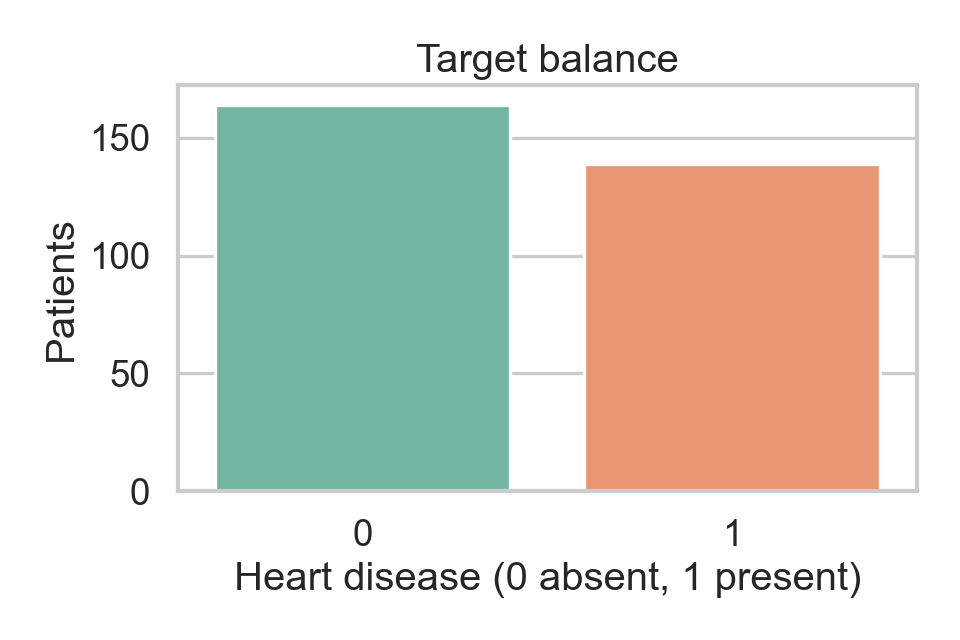
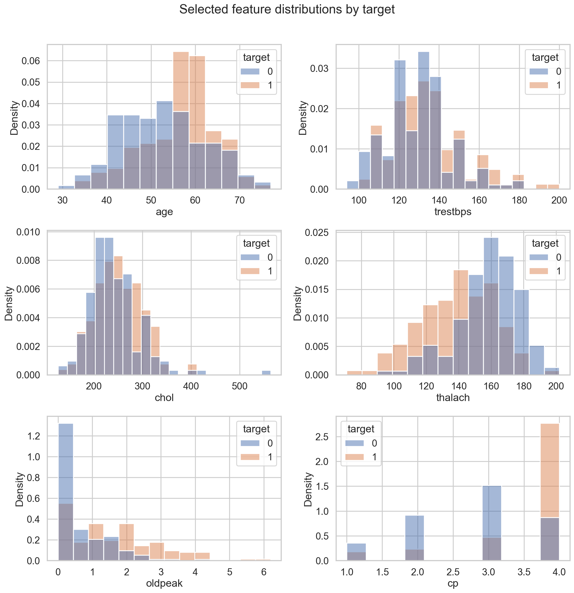
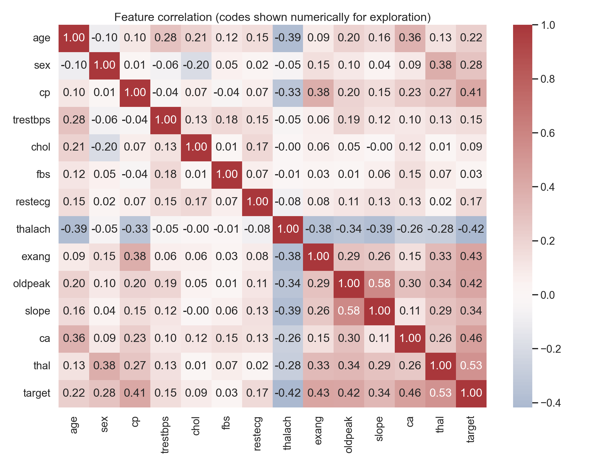
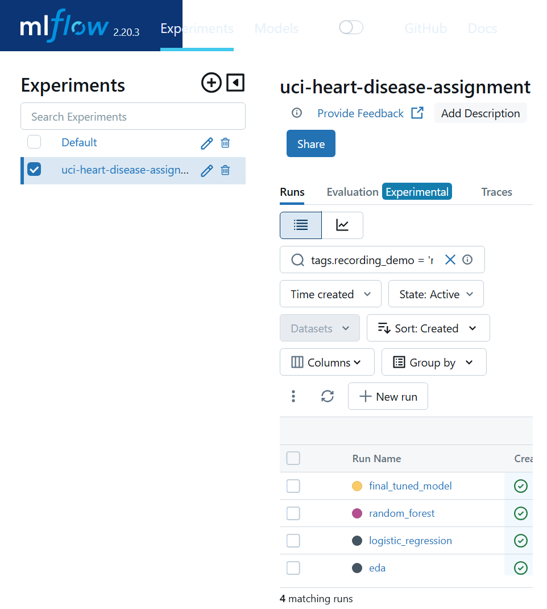
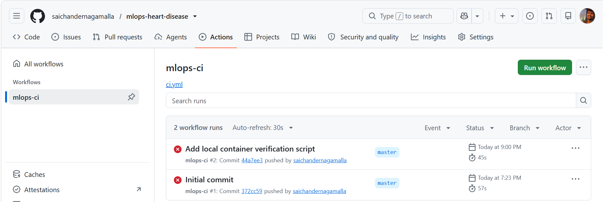
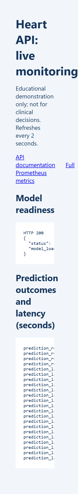

# End-to-End MLOps for Heart Disease Classification

**Course:** Machine Learning Operations (MLOps) AIMLCZG523  
**Assignment:** 01  
**Author:** SAI CHANDER NAGAMALLA  
**Student ID:** 2025AE05029  
**Date:** 20 October 2026  
**Repository:** https://github.com/saichandernagamalla/mlops-heart-disease  
**Local access:** MLflow at `http://127.0.0.1:5000`; verified Docker API and dashboard at `http://localhost:8001/monitor`. Docker Desktop Kubernetes requires an enabled, ready cluster.

> Educational demonstration only. This artifact is not a medical device and cannot be used for clinical decisions.

## 1. Problem and scope

This project demonstrates a pipeline that predicts heart disease presence in the processed Cleveland subset. It maps `num=0` to absence and `num=1..4` to presence. The objective is to practice reproducible data handling, model development, experiment tracking, automated validation, packaging, serving, and monitoring. The project does not establish clinical validity.

## 2. Data acquisition and EDA

The dataset comes from the UCI Machine Learning Repository, Heart Disease dataset (DOI: 10.24432/C52P4X). The acquisition script fetches the processed Cleveland file from the official archive. It contains 303 rows, 13 selected predictors, and the binary outcome under the mapping above. Missing `?` tokens remain null for pipeline imputation.

The cleaned dataset contains 164 negative records (54.1%) and 139 positive records (45.9%). Missingness is limited to four `ca` values and two `thal` values. No rows are discarded; preprocessing imputes those cells within each training fold. Five continuous measurements are scaled and eight coded categorical predictors are encoded.



Positive records have lower average maximum heart rate (139.26 versus 158.38) and higher average ST depression (1.57 versus 0.59). Mean age is 56.63 versus 52.59 years. The distributions overlap substantially and do not imply individual clinical predictions.



Maximum heart rate correlates negatively with the target (-0.417); ST depression correlates positively (0.425). Category-code correlations are descriptive only because codes need not have interval meaning, and none of these associations establish causation.



## 3. Feature processing and model selection

The preprocessing transformer uses median imputation and standardization for numeric features. Coded categories are mode-imputed and one-hot encoded. All steps are in an sklearn Pipeline, and validation folds fit preprocessing independently. Candidates are class-weighted Logistic Regression and Random Forest. Both are compared with shuffled, stratified five-fold cross-validation using accuracy, precision, recall, and ROC-AUC. A small tuning grid is evaluated for the selected candidate using ROC-AUC.

### Cross-validation results

| Candidate | Accuracy mean ± SD | Precision mean ± SD | Recall mean ± SD | ROC-AUC mean ± SD |
|---|---:|---:|---:|---:|
| Logistic Regression | 0.8447 ± 0.0554 | 0.8475 ± 0.0570 | 0.8050 ± 0.0857 | 0.9188 ± 0.0213 |
| Random Forest | 0.8416 ± 0.0222 | 0.8447 ± 0.0415 | 0.8056 ± 0.0438 | 0.9154 ± 0.0204 |

Logistic Regression was selected by mean ROC-AUC (0.9188 vs. 0.9154). Its mean accuracy and precision were also slightly higher; Random Forest had marginally higher mean recall and lower fold-to-fold standard deviations for accuracy and recall. The differences are small relative to the fold variation, so this comparison does not establish a meaningful performance advantage. The selected Logistic Regression pipeline was tuned with `C=0.1`; its best cross-validated ROC-AUC was 0.9208. This is a tuning estimate on the same dataset, not a held-out test result. The five-fold estimates are noisy because the dataset is small.

## 4. Experiment tracking and reproducibility

MLflow experiment: `uci-heart-disease-assignment`. Candidate runs record seed, CV procedure, metric means and standard deviations. The EDA run logs figures. The selected pipeline is stored as `artifacts/model.joblib`, with parameters and CV summary in `artifacts/training_summary.json`. Dependencies are listed in `requirements.txt`; stochastic operations use seed 42. The final MLflow model includes an inferred input/output signature and a three-row input example so its expected schema is visible in the run artifacts.

The latest four finished runs are tagged `recording_demo=ready`. Both candidates also log their estimator parameters, per-fold metric arrays, out-of-fold confusion matrices, and ROC curves. The final run logs the complete tuning results, selected parameters, reusable model and diagnostic plots. Its diagnostics use the same development folds after tuning, not independent validation.

- Logistic Regression run: `4d88ab364a134c2c809f9c4557d5f305`.
- Random Forest run: `7321589e77164a649ac9d077fcd14619`.
- Final tuned run: `a7f870e2af164e1ea71d50eff5ee422f`.
- EDA run: `acd0dfed6e1048f6bd0c9fa07258af50`.
- [Live local experiment](http://127.0.0.1:5000/#/experiments/144320529290097270).



## 5. System architecture

```mermaid
flowchart LR
  U[UCI archive] --> F[fetch_data module]
  F --> D[processed CSV]
  D --> E[EDA figures]
  D --> T[CV training and MLflow]
  T --> M[model.joblib]
  M --> C[Docker image]
  C --> A[FastAPI /predict]
  C --> K[Kubernetes LoadBalancer]
  K --> A
  A --> P[/health, /metrics, /monitor and request logs]
  G[GitHub Actions] --> Q[lint, tests, training smoke]
```

## 6. CI/CD and testing

GitHub Actions installs dependencies, runs Ruff and unit tests, downloads the dataset, generates and tracks EDA, performs a reduced training run, and uploads model, tracking, figure and JUnit artifacts even on failure. The local checkout passes Ruff and **12 tests**. Tests cover both target classes and missingness, preprocessing, unseen categories, both model pipelines, serialization round trips, probability bounds, HTTP prediction contracts, unavailable models, invalid category rejection, metrics, and privacy-preserving request logs.

The latest observed remote run, [39466244558](https://github.com/saichandernagamalla/mlops-heart-disease/actions/runs/39466244558), failed at `pytest -q`. The exact command was reproduced locally: both test modules failed collection with `ModuleNotFoundError: No module named 'src'`. The repository now has `pytest.ini` setting the project import root; the workflow also invokes `python -m pytest`. Repeating the formerly failing entry point now yields **12 passed**. A new remote success is not claimed: the author requested local-only changes and must commit and push before capturing a passing Actions run.



## 7. Packaging, API, and deployment

FastAPI serves the trained pipeline through `POST /predict`. Its response includes a binary prediction, a positive/negative label, and positive-class confidence. The schema uses the original UCI codes, including `slope=1..3` and `thal` in `{3,6,7}`; remapped dataset codes are rejected with HTTP 422. `GET /health` returns HTTP 503 when no model is loaded, making readiness probes meaningful. Docker packages the fitted pipeline under a non-root user. The Kubernetes manifest includes resource limits, probes and a **LoadBalancer** service.

**Reproducible verification:** `scripts/verify_container.ps1` builds the image, waits for model readiness, sends the shared sample JSON, checks prediction and probability bounds, checks metrics, and stops its temporary container. In this environment the default PyPI build hit TLS handshake failures; a configurable trusted HTTPS package index was added without disabling certificate verification.

**Verified current Docker execution (20 October 2026):** The trusted-index build and isolated container checks completed successfully. The recording container `heart-api-demo` is running with host-only port mapping `127.0.0.1:8001 -> 8000`. `/health` returned `{"status":"ok","model_loaded":true}`. The shared UCI-coded request returned `{"prediction":0,"label":"negative","confidence_positive":0.33645}`. `/metrics` returned HTTP 200 and recorded one successful prediction, latency count 1, and latency sum 0.016678784 seconds in this fresh container. These are actual execution values, not a performance benchmark.

**Deployment evidence:** Follow `docs/OPERATIONS.md` for the actual build and endpoint commands. No Kubernetes context was configured at the last check; enabling Docker Desktop Kubernetes, applying the manifest, obtaining a ready deployment and capturing its endpoint remain pending. A manifest alone is not deployment proof.

## 8. Monitoring and limitations

`GET /metrics` exposes prediction outcomes (`success`, `invalid`, `unavailable`, and inference `error`) and a latency histogram. `GET /monitor` provides a live dashboard refreshing every two seconds, showing model readiness, counters, and latency. Structured API logs record method, route, HTTP status and latency, never request-body patient measurements. HTTP tests verify the metrics and dashboard routes, validation counts, and absence of feature values from request logs. A production system still needs durable collection, alerts, authentication, drift monitoring and privacy controls. Historical data, limited sample size, population selection and measurement bias limit interpretation; output probabilities are not calibrated medical risk estimates.



## 9. Conclusion and next steps

The refreshed model, EDA, full MLflow evidence, fixed CI import configuration, 12 passing tests, verified isolated Docker build and inference, request logging, live monitoring dashboard and LoadBalancer manifest are ready locally. Submission still requires a verified Kubernetes deployment, a passing remote CI run after the author pushes, remaining genuine screenshots, and the author's narrated video. Production use would additionally require external validation, calibration, subgroup analysis and operational controls. Do not deploy for patient care.

## 10. References and evidence

- UCI Machine Learning Repository, [Heart Disease dataset](https://doi.org/10.24432/C52P4X).
- Assignment 01 instructions supplied by the course.
- Screenshots: capture the actual MLflow, Docker, API, monitoring, Kubernetes and successful CI views in `screenshots/`. The existing failed-CI image is historical only.
- Video: not yet recorded. Follow [the timed recording flow](../docs/VIDEO_CHECKLIST.md) and replace this sentence with the actual recording link.
- Setup, local access and cleanup: [operations guide](../docs/OPERATIONS.md).
